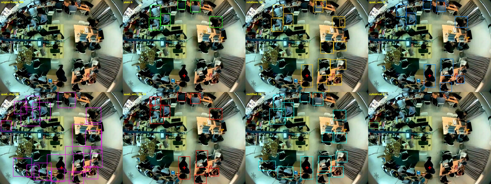
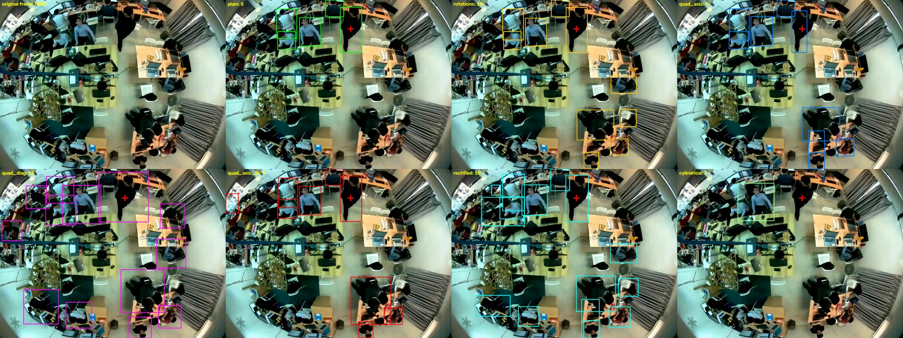

# Comparing view methods for person detection

**Question:** plain YOLO11s misses most people in the overhead fisheye video (upside-down at the
bottom, small/squashed at the edge, seen from straight above at the centre). Which way of
reshaping the frame before YOLO finds the most people, and how much time does it cost?

**Script:** `scripts/compare_methods.py` (geometry in `src/staffid2/fisheye_view.py`)
**Run:** 2026-10-25, Mac GPU (MPS), YOLO11s, conf 0.25, NMS IoU 0.45
**Log:** `logs/compare_methods_20261025-152627.log` · **Data:** `outputs/compare_methods/per_frame.csv`, `summary.csv`

```
../.venv/bin/python scripts/compare_methods.py            # what was run
```

## How the test works

For every method and every frame:

1. Make the method's views of the frame.
2. Run YOLO11s on all views at once (one batch).
3. Map every box back to the original frame (pure geometry, see below).
4. Merge duplicates with NMS (IoU 0.45, the same value as approach 1).
5. Count, time and check against the answer key.

**Frames:** 50 frames spread evenly over the whole video (0, 27, 54, …, 1340), not one 10 s clip.
Most people sit still, so 250 frames in a row would be nearly the same picture 250 times; spreading
them covers walking, the hoodie change, the crowd near the staff member and the exposure dip at the
same cost. The first 2 frames of each method are run once untimed (warm-up).

**Fair size:** each method runs YOLO at its views' own size (rounded up to a multiple of 32), so
every method sees the same pixel detail. Only `quad_axis_2x` enlarges, to answer "does enlarging help?".

### Methods

| Method | Views | YOLO size | Pixels / frame | What it is |
|---|---|---|---|---|
| plain | 1 | 960 | 0.69 MP | the frame as is (baseline) |
| rotations | 4 | 960 | 2.76 MP | whole frame at 0/90/180/270 deg (**approach 1**) |
| quad_axis | 4 | 576 | 0.91 MP | quadrants with 15% overlap; top as is, bottom rotated 180 deg |
| quad_diag | 4 | 704 | 1.87 MP | same quadrants, each rotated so its outward diagonal is up (±45/±135 deg) |
| quad_axis_2x | 4 | 1120 | 3.66 MP | quad_axis enlarged 2x |
| rectified | 4 | 768 | 2.33 MP | 4 virtual perspective cameras, 45 deg tilt, 90 deg FOV, view size chosen so the view centre has the same detail as the fisheye |
| cylindrical | 4 | 1152 | 2.71 MP | panorama strip cut into 4 tiles with 20% overlap (wraps around the seam) |

### Mapping boxes back

Every view stores how its pixels relate to the original frame: a 2x3 affine matrix for
rotations/quadrants (crop + rotate), a per-pixel lookup table for rectified/cylindrical.
A box is mapped by mapping 9 points along each of its edges and taking the box around them.

**Checked:** 300 random pixels per view were mapped back and compared with the original frame.
Rotations and quad_axis: mean difference **0.0** (exact). quad_diag, rectified, cylindrical: **6–8**
(random pixel pairs differ by ~80), i.e. just interpolation smoothing, no geometry error.

## Results (50 frames, means per frame)

| Method | People found | centre / middle / edge | Nested pairs | Staff hit (32 frames) | ms / frame | fps |
|---|---|---|---|---|---|---|
| plain | 2.8 | 0.0 / 2.4 / 0.4 | 0.1 | 0.28 | **12.6** | 79 |
| rotations (approach 1) | 10.4 | 0.0 / 8.4 / 1.9 | 1.2 | 0.78 | 63.3 | 16 |
| quad_axis | 8.4 | 0.1 / 7.0 / 1.3 | 0.4 | 0.84 | **24.9** | 40 |
| quad_diag | **15.2** | 0.1 / 10.5 / 4.6 | **2.7** | **0.94** | 39.7 | 25 |
| quad_axis_2x | 8.9 | 0.1 / 7.7 / 1.1 | 0.6 | 0.88 | 64.8 | 15 |
| rectified | 14.6 | 0.3 / 10.8 / 3.5 | 2.1 | 0.91 | 45.4 | 22 |
| cylindrical | 1.1 | 0.0 / 0.5 / 0.6 | 0.1 | 0.16 | 83.8 | 12 |

- **People found:** boxes after merging. *More is not automatically better*: it includes any
  duplicates NMS did not merge and any false detections. There is no per-person answer key, so the
  pictures below are the check.
- **centre / middle / edge:** where the box centre is: < 150 px, 150–350 px, > 350 px from the image centre.
- **Nested pairs:** pairs of boxes where one box's centre lies inside the other. A rough hint of
  leftover duplicates (people sitting close together also count).
- **Staff hit:** fraction of the 32 sampled frames (with a certain staff position in the answer key)
  where some box contains the staff position.
- **ms / frame:** make views + YOLO + map back and merge. YOLO is 90–99% of it; making views costs
  1–5 ms and mapping back + NMS under 0.4 ms.

Full table with all columns: `outputs/compare_methods/summary.md`.

### Pictures

Red cross = staff position from the answer key. Top-left = original frame.

**Frame 700** (staff walking in the lower middle, upside down in the original):


**Frame 1000** (staff at the top, other people in a group at the bottom right):


## What we learned

1. **Rotations (approach 1) are the most expensive way to fix the upright problem.**
   quad_axis gets 80% of its people and a higher staff hit rate for 40% of the time (25 vs 63 ms),
   because it spends 0.9 MP instead of 2.8 MP. This confirms the "~4x" estimate only partly: real
   saving ~2.5x, since overlap adds pixels and YOLO has fixed per-call costs.

2. **quad_diag and rectified find the most people, ~40–45% more than rotations**, mostly in the middle
   and edge rings, including the left-edge and bottom-left desks that rotations misses. Both handle
   people at diagonal angles, which 90-degree steps leave tilted by up to 45 deg.

3. **quad_diag's count is inflated.** A box found in a view rotated by 45 deg becomes a much larger
   box when mapped back (the box around a tilted rectangle). Those loose boxes overlap a tight
   duplicate too little for NMS to merge them (highest nested-pairs value, 2.7), and they are a poor
   x,y for the tracker. Visible in frame 700, bottom right.
   **rectified boxes stay tight** (the view is only gently curved), so its 14.6 looks like the most
   trustworthy high count.

4. **Enlarging 2x barely helps** (quad_axis 8.4 -> 8.9 people, staff hit 0.84 -> 0.88) for 2.6x the
   time. As discussed: edge people here are not small so much as squashed, hidden by monitors and
   seen at odd angles, so extra size gives YOLO little. In frame 1000 the 2x version also draws one
   big box around a group.

5. **Cylindrical fails** (1.1 people, worse than plain). In the strip each row is stretched
   sideways by radius/r, so a person halfway out is 2x too wide and closer to the centre even more;
   YOLO does not recognise such stretched people.

6. **The centre blind spot remains for every method** (at most 0.3 people per frame within 150 px).
   No reshaping turns a top-down view of a head into a side view.

7. **Real time (25 fps = 40 ms):** on the Mac GPU only plain, quad_axis and (just) quad_diag fit.
   Rectified at 45 ms is close. Rotations do not.

## Limitations (honest list)

- **No per-person answer key.** "People found" is a count, not accuracy; false positives and leftover
  duplicates inflate it. The pictures are the only check, and only 2 frames were drawn.
- **Staff hit favours rotations**, because the answer key's boxes come from approach 1's rotation
  tracker. Other methods beating it here is therefore a conservative result. The key is a Claude-made
  draft not yet checked by the user.
- **Staff hit counts a box containing the point**, so a loose box (quad_diag) hits more easily.
- **Times are from the Mac GPU (MPS), one run.** Laptop CPU will be several times slower; not measured
  (`--device cpu`). Methods with several small views benefit more from batching on a GPU than on CPU.
- **Lens model is a guess** (equidistant, 180 deg, centre = image centre, radius = half diagonal).
  It affects how good the rectified views look, not the correctness of mapping back.
- **Settings untuned:** 4 rectified views at 45 deg tilt leave black areas above/below; quadrant
  overlap 15%; NMS 0.45 copied from approach 1. All tuned on nothing yet; all are flags.

## Possible next steps (not done; for the user to choose)

- Pick a method. On these numbers the candidates are **rectified** (most people, tight boxes) and
  **quad_axis** (cheap and good enough), with rotations as the reference.
- If quad_diag is kept: shrink its mapped-back boxes (they are the box around a tilted rectangle) so
  NMS merges duplicates properly.
- Time the finalists on the CPU, since the live demo may run without a GPU.
- Feed the chosen method's boxes to ByteTrack and see whether tracks break less than in approach 1.
