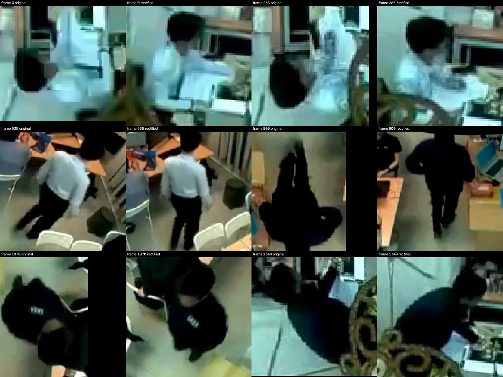
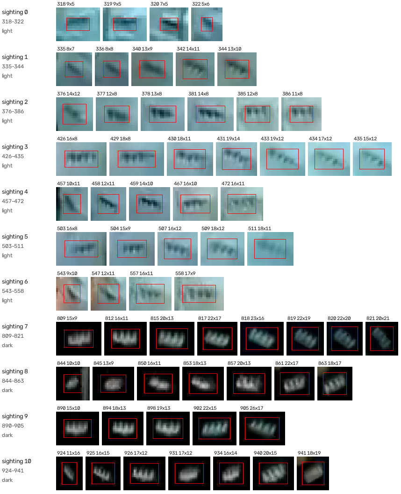
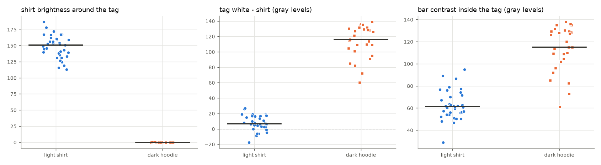
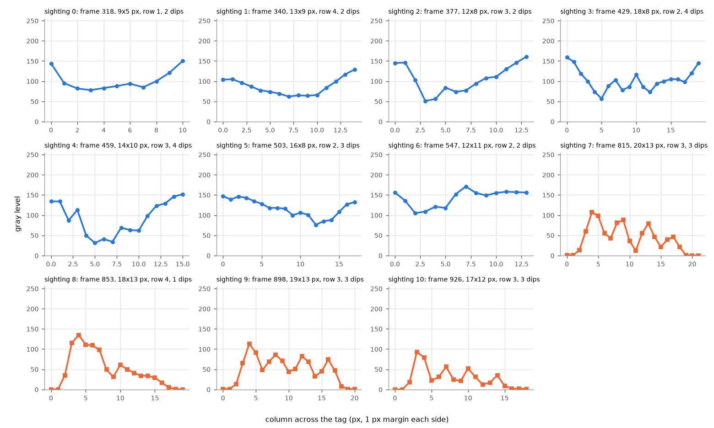
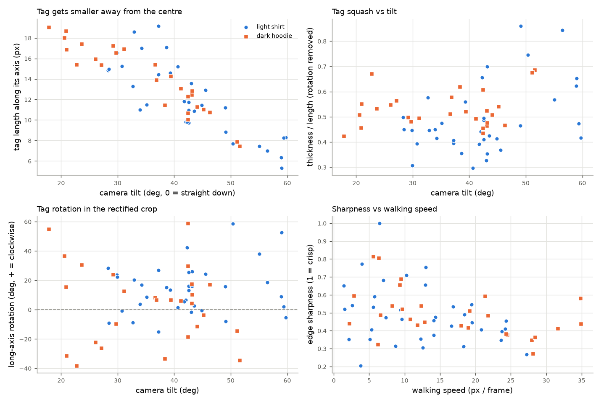
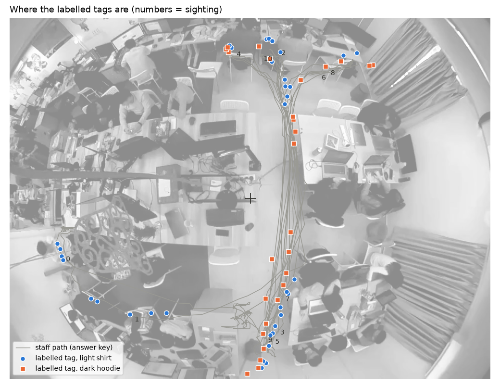

# Step 3a: what the real tag looks like (tag survey)

**Goal.** Before building any tag detector, measure what the staff tag actually looks like in
this camera: its size, how squashed and rotated it is, how it contrasts with the shirt, whether
the bars are resolved, how blurred it is, and where in the image we have examples. These numbers
set the ranges for the synthetic training data (step 3b) and tell us which cases the detectors
(3c NCC, 3d classifier) must handle.

**Role of these labels (important).** The tags labelled here are **never used as training data
or templates**. Detectors will learn only from the brief's tag photo and a drawn tag, plus
augmentation. The video tags are used for two things: measuring (this step) and testing (3c/3d).
That keeps the test honest: a detector that scores well has learned from the brochure photo and
works on real footage, which is what the unseen interview video will check.

## How it was done

### 1. Person-centred rectified crops (`src/staffid2/person_crop.py`)

For each person box, a virtual perspective camera is aimed straight at the person. Everything is
computed from the box; nothing is chosen per frame:

- **azimuth** = direction of the box centre seen from the image centre
- **tilt** = distance from the image centre ÷ lens focal length (equidistant lens: r = f·θ)
- **field of view** = angular size of the larger box side + 15 % margin
- **size** = "native": the crop centre keeps exactly the fisheye's own detail

The person comes out upright (outward = up) and undistorted. Original vs rectified:



The lens model is the same guess used for detection (equidistant, 180°, centred, radius = half
the diagonal). It is not calibrated.

### 2. Crops and contact sheets (`scripts/staff_crops.py`)

Every 5th frame: the staff crop (box from the answer key) and up to 3 negatives (other tracks,
skipping boxes with IoU > 0.3 with the staff box, which are usually duplicates of the staff
member). Result: 269 staff crops, 804 negatives from 115 tracks, 1.9 s. Crops are saved in
`data/tag_crops/` (git-ignored, rebuilt in 2 s). Contact sheets (grids of thumbnails in time
order) are saved in `outputs/tag_crops/staff_sheet_*.jpg` for a quick visual overview.

### 3. User labelling (`scripts/label_tag.py`)

The user marked **sightings** (continuous frame ranges where the tag is visible in the pixels)
and dragged a box around the tag on a few frames per sighting, in the enlarged rectified crop
(pixel grid, zoom up to ×4, 1-px nudging). Rules agreed with the user:

- A sighting means the tag can be **seen** (even as a blurred patch or a few dark bar pixels),
  not just that the person faces the camera.
- Boxes go on a few frames per sighting where the look changes (size, angle, blur, clothing),
  not on every frame. A soft edge is placed halfway through the blur.
- Passes that look the same as an already labelled one were skipped. **Frames outside every
  sighting are "not labelled", not "no tag".**

Result: **11 sightings, 158 frames, 63 boxes** (4–8 per sighting), in
`ground_truth/tag_labels.json`, `tag_boxes.csv`, `tag_sightings.csv`.

Not labelled, by the user's decision:
- **Seated period, frames 0–274:** the tag is physically there, but too small and blurred to
  see. No pixel-based detector can be expected to find it there.
- **After frame 942:** the same walking movement as the earlier hoodie passes, judged already
  covered.

### 4. Measurements (`scripts/tag_survey.py`, `src/staffid2/tag_measure.py`)

For each box, on the gray rectified crop:

| Measure | How | Why |
|---|---|---|
| `length`, `thickness`, `angle_deg` | spread (2nd moments) of the pixels that differ from the shirt; length = √(12·variance) along the long axis | tag size and rotation **independent of the axis-aligned box** |
| `shape_ratio` | thickness / length | how squashed the tag looks |
| `shirt_median` | median of a 3-px band around the box | light vs dark clothing (dark if < 100) |
| `tag_vs_shirt` | 90th percentile inside − shirt | does the white card stand out? |
| `bar_contrast` | 90th − 10th percentile inside | bars vs white inside the tag |
| `n_dips` | dips in the **best single pixel row** of the middle band (prominence ≥ 15 % of the row's range and ≥ 8 gray levels) | are the bars resolved? |
| `sharpness` | steepest step between neighbouring pixels in that row ÷ its range (1 = crisp) | blur |
| `tilt_deg`, `speed_px` | camera aim; staff box-centre speed from the answer key | explain size and blur |

Two first attempts were replaced after looking at the results: averaging rows before counting
bars (smeared the bars as soon as the tag was rotated: hoodie tags showed 0 bars), and a gradient
direction for the bar angle (dominated by the tag's outer edges, gave ±85° nonsense). The
`tag_measure.py` functions are shared, so step 3b can measure synthetic tags the same way and
check they match.

## Results

### All labelled tags



Each row is a sighting, with the tag enlarged (red = the user's box). Two things stand out at a
glance: the tags are **often rotated**, and they look **completely different on the two shirts**.

### Shirt colour changes what the tag looks like



| | light shirt (36 boxes) | dark hoodie (27 boxes) |
|---|---|---|
| shirt brightness | 113–187 | **0** (clipped to black) |
| tag white − shirt | **−17 to +27** (median +7) | **+60 to +139** (median +116) |
| bar contrast | 29–95 (median 61) | 61–138 (median 115) |

- **Light shirt:** the white card is invisible. It is as bright as the shirt and sometimes
  darker. Only the **dark bars** show: a small group of dark marks with no outline.
- **Dark hoodie:** a bright card on pure black, with the bars as darker gaps (a "comb" look).

A detector that only knows "white card with black bars" would miss the light-shirt case. The
synthetic data and the NCC templates need both looks.

### Bar profiles



One box per sighting: brightness along the best row. On the light shirt the profile is a dip
(the bar block) with 2–4 smaller dips inside. On the hoodie it is a plateau (the card, ~80–130)
on black, with the bars as dips of 30–60 gray levels.

The bars were resolved (≥ 2 dips in a row) in **48 of 63 boxes**. The 15 without are explained
by three conditions:
- **small:** length < 10 px (320, 322, 335, 336, 844, 845)
- **strongly rotated:** > 30° (322, 336, 457, 819–821, 924, 941), where no row crosses all bars
- **fast walking:** 28–35 px/frame (819–821, 941)

Light-shirt boxes sometimes count 4–5 dips: the edges of the bar block and noise add dips, so
`n_dips` means "bars are resolved", not an exact bar count.

### Size, squash, rotation and blur



- **Size follows the tilt closely:** the tag is ~17–19 px long near the centre (tilt 20°) and
  ~5–8 px at the edge (tilt 55–60°). This is the clearest pattern in the data, and it is
  geometry (distance from the camera), so it should transfer to other videos.
- **Squash (thickness/length) 0.30–0.86**, median 0.49, with no clear trend with tilt. It mixes
  the tag's own shape, the chest angle and the blur.
- **Rotation −38° to +59°**, median +9°, even in the upright rectified view (the chest is
  turned or the person leans). With the original fisheye view it would be any angle.
- **Sharpness 0.2–1.0**, only weakly related to walking speed: most tags are soft anyway at this
  size, and fast walking adds a bit more.

### Where the examples are (coverage)



Almost every labelled tag lies on the **central corridor**, plus sighting 0 at the bottom left.
Sightings 3, 5, 9 (bottom) and 2, 4, 10 (top) are at nearly the same spots: they are repeat
crossings. Distance from the image centre covers 105–395 px, but the left and right parts of the
room have **no examples**. That is a property of this clip, not of the method, and it is the
main reason the synthetic data must cover more than the measured ranges.

### Measured ranges (`outputs/tag_survey/ranges.csv`)

| measure | min | 5 % | median | 95 % | max |
|---|---|---|---|---|---|
| tag length (px) | 5.3 | 7.4 | 12.8 | 18.5 | 19.2 |
| tag thickness (px) | 3.5 | 4.0 | 6.0 | 9.1 | 10.4 |
| thickness / length | 0.30 | 0.35 | 0.49 | 0.70 | 0.86 |
| rotation (deg) | −38 | −31 | +9 | +51 | +59 |
| bar contrast | 29 | 50 | 76 | 135 | 138 |
| sharpness | 0.21 | 0.30 | 0.46 | 0.77 | 1.0 |
| camera tilt (deg) | 18 | 21 | 42 | 59 | 60 |
| walking speed (px/frame) | 1.4 | 2.2 | 12.6 | 28.4 | 34.9 |

## What this means for step 3b (augmentation)

Suggested starting ranges, **wider than measured on purpose** because the measurements come from
one person, one clip and mostly one corridor. To be confirmed in 3b by measuring the synthetic
tags with the same functions and comparing the distributions.

| Augmentation | Measured | Suggested range | Reason for widening |
|---|---|---|---|
| tag length | 5–19 px | **4–24 px** | other positions / taller people in the test video |
| squash (thickness/length) | 0.30–0.86 | **0.25–0.9** | chest angle varies |
| rotation (rectified crops) | −38 to +59° | **±70°**, symmetric | leaning either way is equally likely |
| shirt / background | white-ish and black | **light, dark and mid-tones**, pasted on real torsos | grey or coloured clothes are not in this clip |
| card vs shirt contrast | −17 to +139 | include **card invisible** (≈ shirt) | the light-shirt case |
| blur | sharpness 0.2–1.0 | match the sharpness distribution, plus motion blur | measure synthetic sharpness to calibrate |
| downscale then upscale | (tag 5–19 px) | render large, shrink to target size | the bars become 1–2 px, like the real ones |

## Assumptions and limitations

- **Labels are approximate.** Boxes are hand-drawn on 5–26 px objects, so ±1–2 px is expected.
  Ranges are meant to be widened anyway.
- **Light-shirt shape measures the bar block**, not the white card (the card does not differ from
  the shirt). Length/thickness on light shirts are therefore slightly smaller than the card.
- **Rotation is unstable for near-square tags** (e.g. 941, 18×19 box).
- **Dark/light split is a threshold** (`--dark-max 100`). In this clip it is unambiguous (0 vs
  ≥ 113), but a grey shirt in the test video would sit in between.
- **One person, one clip, mostly the corridor**; frames 819–821 use the user's manually clicked
  staff box (slightly less exact crop). The lens model is a guess, so crops near the edge may be
  slightly warped.
- **Sharpness is a crude blur measure** (one row, one step). It ranks blur, but it is not
  calibrated to a Gaussian sigma; 3b will calibrate it by measuring synthetic tags.

## How to reproduce

```
cd approach2
../.venv/bin/python scripts/staff_crops.py     # crops + contact sheets (2 s)
../.venv/bin/python scripts/label_tag.py       # user tool (labels already in ground_truth/)
../.venv/bin/python scripts/tag_survey.py      # measurements + figures (1 s)
```
