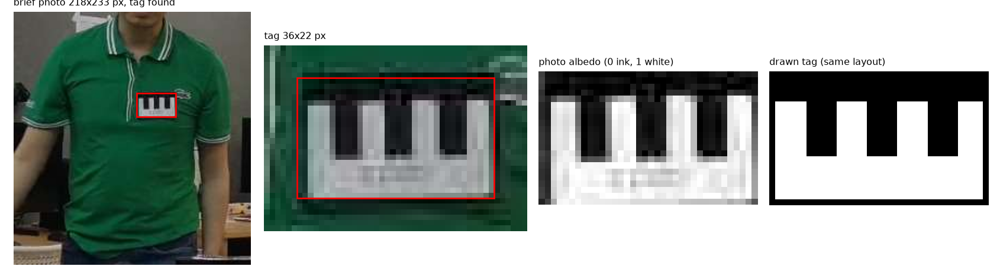
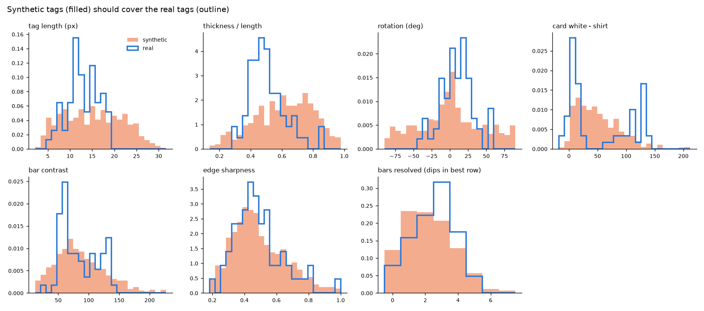
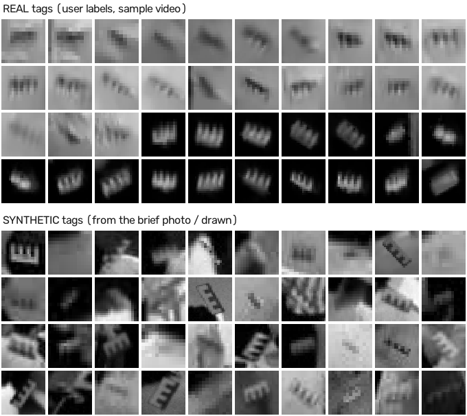

# Step 3b: synthetic tags from the brief's photo

**Goal.** A tag image generator that never uses the sample video's tags: the NCC templates (3c)
are made with it, and its output was compared with the real tags measured in 3a.

## 1. The source tag (automatic, `src/staffid2/tag_source.py`)

The brief PDF contains three JPEGs. Only the first is used: the green-shirt reference photo
(218×233 px). The other two are snapshots of the staff member **from the sample video itself**;
using them would leak test data into the templates.

`pdf_jpegs` pulls the embedded JPEGs out of the PDF (no PDF library needed: they are stored as
plain JPEG streams). A 2400-px macOS render of the page was also tried: it is only an enlargement
of the same 218-px photo, with no extra detail.

`find_tag`: (1) bright, unsaturated blobs → the most card-shaped, best-filled one (the white
card); (2) the black band on top is not white, so the box is extended upward and sideways while
a row/column is mostly "not shirt" (green clearly beating red and blue, margin 8). A first
margin of 20 also swallowed the shadowed shirt around the tag (box 43×29); 8 gives the card
with its 1-px outline: **36×22 px**.

**Tag layout** (measured automatically, `measure_layout`): a white card, aspect 1.64, a black
band over the top 23 %, and **3 black bars hanging from it to 64 % of the height** (like piano
keys), 1-px dark outline. This explains the two looks found in 3a:
- **light shirt:** the white card merges with the shirt, so only the black band + bars show
  (a dark comb, teeth down);
- **dark hoodie:** the band and bars merge with the hoodie, so only the white parts show
  (a white comb, teeth up).

Two albedo maps (0 = ink, 1 = white) are used: the photo's tag, and a clean **drawn tag** with
the same layout (`draw_tag`).

**Please check:** `figures/step3b_source.png` (is the red box the tag?).

## 2. The renderer (`src/staffid2/synth_tag.py`)

One render: card length L (long side), thickness = ratio·L, rotation, optional 180° flip,
small shear → levels per look (light: card ≈ shirt; dark: shirt near black, card well above it;
mid: grey/coloured shirt, not in the sample video) → drawn at 8× and averaged down (pixels
integrate light) → Gaussian blur, motion blur, noise, JPEG.

## 3. Checked against the real tags

600 synthetic tags were pasted onto **real torsos** (chest area of other people's crops, never
the staff member), the look chosen first and then a torso of matching brightness (most people in
this clip wear dark clothes; drawing torsos at random gave only 18 % light-shirt tags). Each was
measured with the **same functions as the real tags** (`staffid2.tag_measure`).

Adjustments made after comparing (each documented in `synth_tag.DEFAULT_RANGES`):

| Problem seen | Change |
|---|---|
| synthetic too round (measured thickness/length median 0.69 vs 0.49) | drawn ratio 0.25–0.9 → 0.15–0.6 (blur makes small tags look rounder) |
| hoodie tags too bright (bar contrast up to 230, real ≤ 138) | dark-look card 70–200 → 60–170 |
| light-shirt bars too dark (contrast 226, real ≤ 95) | ink = 5–50 % of the card level instead of near black (1–2 px bars never look black) |
| too few light-shirt tags | look chosen first, then a matching torso |

Final coverage: the real values lie inside the synthetic 1–99 % range for every measure (100 %),
except card-minus-shirt (92 %). The synthetic tags are still a little rounder on average
(median 0.63 vs 0.49) but span the whole real range; not tuned further, since the NCC templates
(3c) do not depend on these distributions.

**Not used in the end:** the full random renderer was meant mainly for training a classifier,
which the user dropped (NCC only). NCC uses the same renderer, but with fixed clean settings.

## Files

- `scripts/synth_tags.py` (2 s) → `outputs/tag_source/{photo_albedo,drawn_albedo}.png`,
  `layout.json`; `outputs/synth_tags/{synth_measurements,compare}.csv`; the three figures above.
