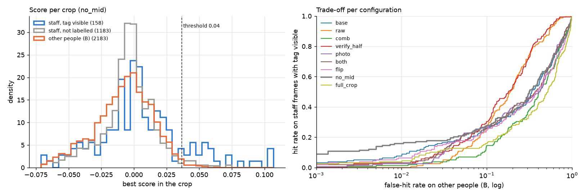
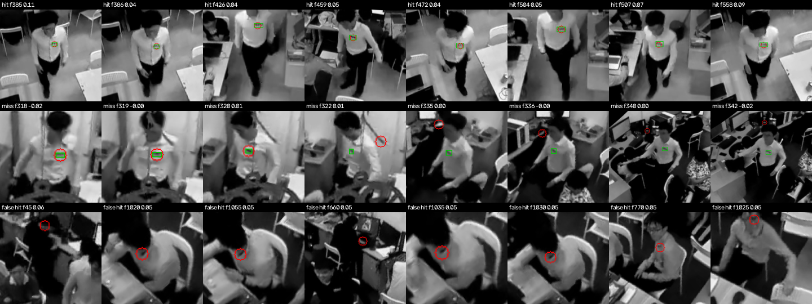
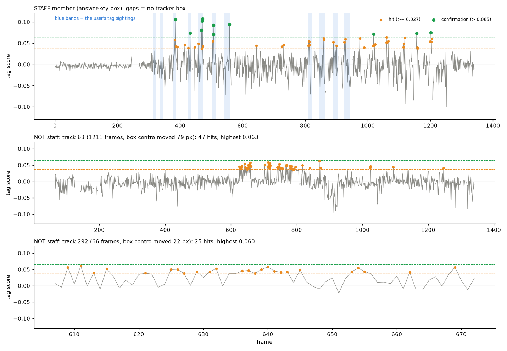
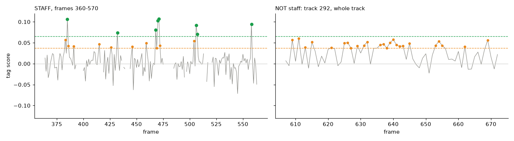
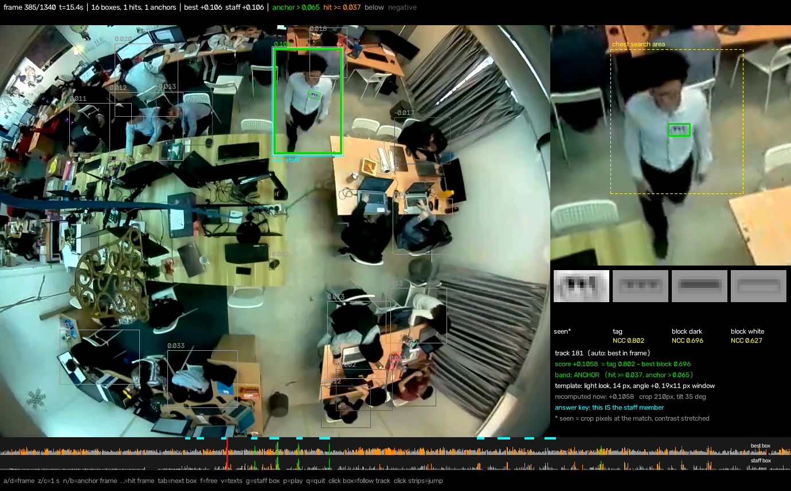

# Step 3c: NCC tag detector

**Goal.** For a person crop (rectified, upright, gray), say whether it shows the tag, with a score
and the tag's position. Templates come only from step 3b (brief photo / drawn tag); the user's
video tags are used only to test.

## How it works (`src/staffid2/ncc.py`)

- **Template bank:** clean synthetic tags with a 2-px margin of shirt, for every combination of
  length (6, 8, 11, 14, 18 px), drawn thickness ratio (0.3, 0.5), rotation (−60…60° in 20° steps)
  and look (light: dark comb on a plain background; dark: white comb on black). Chosen
  configuration `no_mid`: 140 templates, drawn tag.
- **Search area:** the chest part of the crop, x 25–80 %, y 10–70 % (3a: real tag centres at
  x 40–65 %, y 15–58 %, widened). A body-shape prior, not a region of this video.
- **OpenCV `TM_CCOEFF_NORMED`:** zero-mean, normalised, so brightness and contrast do not matter.
  Windows flatter than std 6 are ignored (NCC divides by ~0 there).
- **Score ("verify"):** raw NCC picks the position and template; then two **"no bars" twins** of
  that template (teeth filled with ink = a solid block; teeth filled with white = only the band)
  are matched at the same spot. Score = raw − best twin: "does the comb fit better than a plain
  blob of the same size and angle?"

## Evaluation (`scripts/ncc_eval.py`)

- Positives: the staff crop in the 158 frames of the user's 11 sightings; 63 have a tag box.
- Negatives: everyone else every 5th frame (3859 crops, 171 tracks), minus boxes overlapping the
  staff box (IoU > 0.3, duplicates of the staff member).
- **Honest threshold:** negatives split by track ID (even = A, odd = B). Threshold = score that 2 %
  of half-A crops exceed; every false-hit number is on half B.
- On-tag: on the 63 boxed frames, the match centre lies on the user's box (±2 px).

## What was tried, in order

| Config | Score | Hit rate, visible tag | Sightings | On tag | False hits B | Worst other person |
|---|---|---|---|---|---|---|
| raw | best NCC | 6.3 % | 5/11 | 3/63 | 3.8 % | 32 % of their frames |
| comb | (tag − twin) maximised over the area | 1.3 % | 2/11 | 1/63 | 0.7 % | 3.8 % |
| base | verify, light + dark + mid looks | 10.8 % | 9/11 | 6/63 | 1.4 % | 9.5 % |
| **no_mid** | **verify, light + dark looks** | **15.8 %** | **9/11** | **10/63** | **1.0 %** | 13 % (90 % of people ≤ 2.3 %) |
| photo | as base, photo tag | 6.3 % | 5/11 | 2/63 | 2.6 % | 19 % |
| both | as base, photo + drawn | 6.3 % | 7/11 | 3/63 | 2.1 % | 17 % |
| flip | as base, + upside-down tags | 5.1 % | 5/11 | 3/63 | 0.8 % | 6.9 % |
| full_crop | as base, whole crop | 9.5 % | 7/11 | 5/63 | 2.1 % | 10.5 % |

What each step taught:
1. **raw:** location is good (best match on the tag 75 % of the time) but a plain small blob
   scores as high: the 8 strongest false hits (0.97) were all one man's white chest logo on a
   black polo, the hoodie look without bars.
2. **comb everywhere:** kills the blobs but, maximised over the whole area, picks clutter
   (on the tag only 38 %).
3. **verify** = raw for *where*, twins for *whether*: best of the three.
4. **no_mid:** 57 of 69 false hits came from mid-tone templates; real hits used only light/dark.
   Dropping them helps on this clip. **Risk:** a staff member in a grey/coloured shirt in the test
   video would lose the matching look. Kept as an open risk.
5. The **drawn** tag beats the photo's (the photo is 36 px, blurry and slightly uneven), and
   flipped templates hurt (all real tags hang the same way in upright crops).

Rows: hits (red circle on the green user box), misses, strongest false hits on other people.
Misses are mostly the tiny tags (sightings 0–1, 5–9 px): the match lands on the tag but the bars
are too small for the twin test. False hits: pocket/button lines, collar, glasses, desk items.

Per sighting (`outputs/ncc_eval/per_sighting.csv`): 9 of 11 found; sightings 0 and 1 (smallest,
tilt 43–60°) never.

## Conclusion

Per frame the detector is weak (16 % of visible-tag frames) and some seated people repeat the same
weak false hit for hundreds of frames, so **counting hits per track does not identify the staff
member** (checked on all tracked boxes: the most-hit tracks were seated non-staff people, e.g.
track 292 hit in 25 of 66 frames). But **strong hits are clean**: no other person's box ever
scores above 0.065, and 11 staff boxes do (next section). How to use that for following the
staff member is step 4 (a first version is under review in `review_pending/`).

## Limitations

- Every comparison above was made on this one clip; `no_mid` was chosen by looking at its false
  hits, and the 2 % / chest-area / std-6 settings were not tuned further.
- Speed: ~10 ms per crop on one CPU core (0.7 ms to cut the crop, 9.6 ms to match 140
  templates). An earlier version of this doc said "1.6 ms per crop per core": that was the wall
  time per crop with 7 processes in parallel, not per core.

## Scoring every tracked box (`scripts/score_tracks.py`)

All 20 863 tracked boxes of the sample video were scored with `no_mid` → `data/tag_scores/ncc_track_scores.csv`
(40 s with 7 processes). **Each score uses only its own frame**; the whole video is done in one
go only so the viewer can move around instantly.

| Score over all boxes | median | 90 % | 99 % | highest |
|---|---|---|---|---|
| other people | −0.003 | 0.021 | 0.040 | 0.065 |
| staff member (answer key) | −0.003 | 0.021 | 0.063 | 0.107 |

Most staff boxes look like anyone else's (tag hidden or too blurry). 292 frames have a hit
(≥ 0.037) somewhere, mostly on other people; 11 frames have a box above 0.065, all on the staff
member: 385, 432, 468, 470, 471, 506, 507, 558 (white shirt), 1019, 1156, 1201 (hoodie). The
0.065 line is the highest score of any non-staff box among even track IDs; on odd IDs nobody
reaches it (max 0.0645). It uses the answer key, so it can only be set on the sample video.

### Score over time: real tag vs repeated false hits (`scripts/score_charts.py`)

- **Staff member:** around 0 like anyone else most of the time (no hit at all while seated,
  0–274), with rare **tall, short spikes** (1–3 frames, up to 0.107) while walking, almost all
  inside or next to the user's sightings: the tag faces the camera for an instant.
- **Track 63** (seated the whole video, box centre moved 79 px in total): 47 hits, most in a
  cluster at 630–800 hovering at 0.04–0.06; highest 0.063. The staff member is far away then
  (around x 470, y 600), so it is not the staff tag leaking into the box.
- **Track 292** (seated, 66 frames, moved 22 px): 25 hits, bouncing between 0.04 and 0.06 again
  and again; highest 0.060.

Over all tracks: staff tracks with hits have hit runs of 1–2 frames (max 5) on short walking
tracks; other people's hits are spread over many different seconds of long seated tracks. So
**short bursts on a moving person are the real sign, a steady trickle on a still person is the
false one**, and a filter that ignores 1–2 frame spikes would remove most real hits. The margin
is thin: 0.063 and 0.060 against a 0.065 confirmation line.

## Viewer (`scripts/tag_score_viewer.py`, user tool)

Every tracked box with its score, coloured green (> 0.065), orange (hit ≥ 0.037), grey (below),
dark (negative); the matched spot is outlined. Right panel: the selected box's upright crop with
the chest search area and the match, then **seen / tag / block dark / block white** side by side
with their NCC values (score = tag − best block, recomputed live; matches the CSV to 5e-5).
Bottom strips: the best box's and the staff box's score in every frame, the user's sightings in
cyan. Keys a/d (frame), z/c (1 s), n/b (strong-hit frames), . , (hit frames), tab, click a box to
keep it selected, p play, q quit. The viewer only shows tag scores: it does not decide or follow
the staff member (the cyan box is the answer key, for comparison).

## Live scoring (`scripts/score_tracks_live.py`, first version)

Reads the video frame by frame and scores that frame's tracked boxes (`FrameScorer`), using
nothing from other frames; output has the same columns (viewer: `--scores`) and `--compare`
checks it against the batch scores (same scores, max difference 5e-5).

| Threads | Scoring per frame (median, 16 people) | Frame rate from scoring alone |
|---|---|---|
| 1 | 153 ms | 6.5 fps |
| **4 (default)** | **67–75 ms** | **13–14 fps** |
| 7 | 119 ms | 8.4 fps (slower: the Python parts of the matcher compete for Python's lock) |

Real time at 25 fps leaves 40 ms per frame, and person detection + tracking already take ~48 ms
on the Mac GPU, so the full live pipeline would run at about 8 fps today (48 + 70 ms one after the other) (measured on the
user's laptop, 15 cores; not measured on a plain CPU-only machine).

Not done yet: making it fast enough for 25 fps. Ideas: only the 1–2 template sizes that fit
the crop size (the tag's size follows the person's size), scoring every 2nd–3rd frame (a sighting
lasts 10+ frames), re-checking seated people less often.
