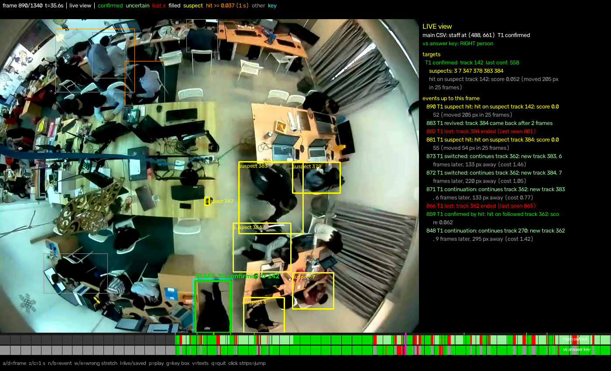
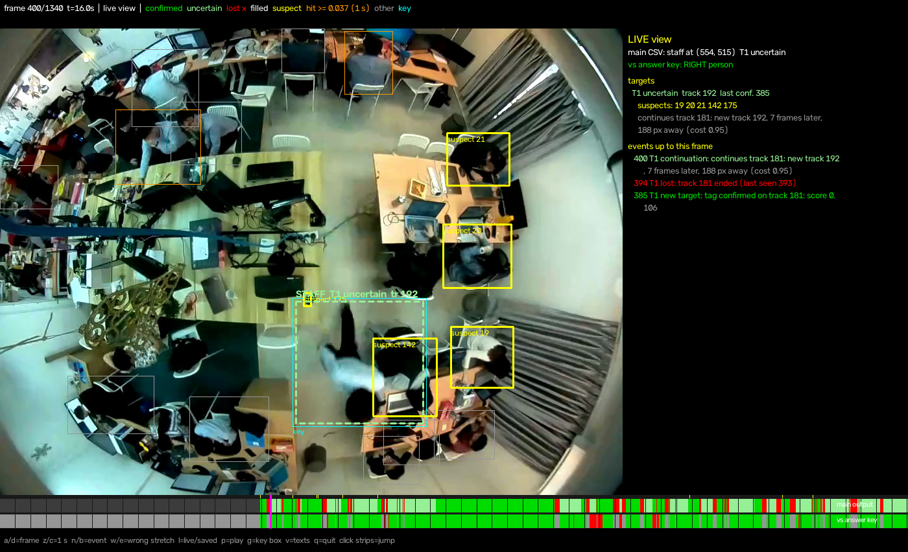
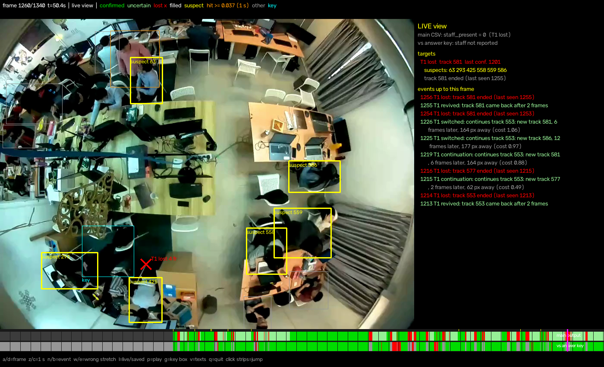

# Step 4.2–4.5: live follower, viewer, score, suspects

Rules: `step4_rules.md` (short version: `tag_recognition_&_staff_tracking.md`). Code:
`src/staffid2/follow.py`, scripts
`scripts/follow_staff.py` (run + score) and `follow_viewer.py` (user tool).
Special cases: case 1 (suspects after a loss, for the ID swap) is built; centre blind spot and
standing still are not.

## How it runs

```
../.venv/bin/python scripts/follow_staff.py      # ~1 s; every setting is a flag
../.venv/bin/python scripts/follow_viewer.py     # a/d frame, p play, l live/saved
../.venv/bin/python scripts/follow_staff.py --suspects false   # without 4.5
```

The follower reads the saved tag scores in frame order. Frame t is decided only from frames
0..t (each score uses only its own frame, so this is the same as live). Following itself takes
**0.2 ms per frame**; the cost of live is the tag scoring (~70 ms/frame, step 3c).

Outputs (`outputs/follow/`): `staff_live.csv` and `staff.csv` (`frame,staff_present,x,y`,
live and with the end fill), `main_detail.csv` / `main_live_detail.csv` (+ target, state, track,
source), `targets_live.csv` / `targets.csv` (every target every frame, with the reason and the
current suspects), `events.csv`, `score.json`.

## Result on the sample (answer key, right = within 25 px)

| | 4.2 live | **4.5 live** | 4.2 saved | **4.5 saved** |
|---|---|---|---|---|
| 1. first confirmation | 385 | 385 | 385 | 385 |
| 2. right when it says "staff" | 686 / 818 = 83.9 % | **772 / 812 = 95.1 %** | 81.7 % | **881 / 956 = 92.2 %** |
| 3. right after the first confirmation | 71.8 % | **772 / 956 = 80.8 %** | 81.7 % | **92.2 %** |
| right over all 1341 frames | 51.2 % | 57.6 % | 58.2 % | 65.7 % |

- Frames 0–384: no output by design (the tag has not been seen yet). The staff member is present
  then, so "all frames" can never pass ~71 %.
- Live, 144 frames after 385 say "not present" because the target is LOST; the end fill turns
  them into 109 right + 35 wrong.
- Of the 40 wrong live frames, 31 are in the swap stretch 871–973 (the target sits on another
  walking person, track 384, until the staff member's next hit); 9 are 1–2 frame wrong picks
  right after a loss, corrected by the switch rule a few frames later.
- Only one target is created now (at 385); the confirmation at 1019 lands on the target's own
  track (in 4.2 it started a second target, T2, and T1 stayed green on a wrong person).

## 4.5 case 1: suspects after a loss

**Why.** At the swap (865) the staff member was handed old track IDs of other people (142, which
existed since 278, then 369, born at 851). The continuation search only accepts tracks born
after the loss, so the right person was never a candidate; the follower guessed among wrong
people for ~150 frames. The tag did show on the right tracks meanwhile (hits at 890 and 900 on
142, at 925 and 928 on 369), but a hit only counted on the followed track.

**Rule.** Next to the continuation search, not instead of it:
1. When a target is lost, a **suspect window** opens (`suspect_time`, 125 frames = 5 s).
2. Every person within `suspect_radius` (250 px) of the loss point while the window is open
   becomes a **suspect** (yellow), **old tracks included**, unless owned by another target.
3. The movement guess (light green) carries on as before, so the output does not go blank.
4. A hit (≥ 0.037) on a suspect that **moved** at least `suspect_move_px` (40 px) over the last
   `move_frames` (25) moves the target there (green). The move filter keeps seated people's
   repeated false hits out.
5. **Latest hit wins** (`suspects_until_confirmed`): the window stays open after a suspect hit,
   and the track we leave becomes a suspect; a later hit on another suspect moves the target
   again. The window closes at a real confirmation (> 0.065) or after 5 s.

6. **Colour (user's choice):** while the window is open, a target made green by a hit is shown
   **light green** (state UNCERTAIN in the outputs): it can still move. Solid green only after a
   real confirmation or when the window ends. Result: 196 solid-green frames, all right; 616 light
   green, 576 right. The CSV is unchanged by this.

**What was tried.**

| Variant | live right when said | live after first | saved | What happened |
|---|---|---|---|---|
| no suspects (4.2) | 83.9 % | 71.8 % | 81.7 % | |
| first hit wins | 81.6 % | 71.7 % | 81.6 % | another walking person near the staff member (track 384, never staff) hit 0.055 at 881, nine frames before the staff member's 0.052 at 890; the window closed, the real hit was ignored |
| **latest hit wins** | **95.1 %** | **80.8 %** | **92.2 %** | 5 suspect hits, all in the swap: 881 → 384 (wrong), **890 → 142** (right), **925 → 369** (right), 964 → 384 (wrong), **974 → 435** (right); each wrong move was overruled by the next real hit within ~10 frames |



Frame 890: the hit on suspect 142 (0.052) has just moved the target onto the staff member (green,
"STAFF"); the other people near the loss point are still yellow suspects, among them 384 (the
other walking person) and seated people whose hits do not count because they do not move.

**Limits.**
- One swap in one video. The "latest hit wins" choice was made after seeing that the other
  walking person also gives hits; on a new video the balance of right and wrong hits may differ.
- The suspect list is large (up to ~11 people within 250 px, many seated); only the move filter
  stops seated people's false hits. Track 63 (47 hits, seated) appears as a suspect at 1260.
- A wrong suspect hit moves the output to the wrong person until the next hit (here ~10 frames).
- `suspect_radius`, `suspect_move_px`, `move_frames`, `suspect_time` are first guesses, not tuned.

## What changed while building 4.2 (each re-scored; live "right when said" / "after first")

| Version | live right when said | live right after first | Why the change |
|---|---|---|---|
| rules as written | 53.2 % | 48.7 % | a lost target took the first plausible track, often a wrong one born a few frames before the right one; that wrong guess was then made green by a seated person's false hits |
| + switch while UNCERTAIN | 73.4 % | 52.4 % | at each break the right track ranks first among the candidates once its speed is known (checked on all 21 breaks in the answer key: rank 1 in 16, rank 2 in 2, rank 5 in 1 (standing still), not a candidate in 2: the swap, where the "continuation" is an old revived ID or a track born before the loss) |
| + keep the earlier loss point after a brief guess | 67.0 % | 62.7 % | the clothes-change stretch 564–846: the guess (track 267, 2 frames) moved the loss point 218 px away and the real track 270 was no longer reachable |
| + main target = last real confirmation, stays main while LOST | 69.2 % | 62.7 % | the output jumped to an older, wrong target whenever the main one was lost |
| + `trust_frames` (10) | 83.9 % | 71.8 % | at 1254 a correct guess (35 frames) was thrown away for the old loss point |
| + suspects, latest hit wins (4.5) | **95.1 %** | **80.8 %** | above |

These rules are generic (no frame, place or colour of this video), but every one was found by
looking at this video's failures, so the numbers are optimistic for an unseen video.

The hit threshold for turning a light-green target green (0.037) was also tried at 0.045 and 0.05
(before 4.5): the CSV was identical, because light green and green both count as "staff".

## Viewer



The right panel lists the targets with their reason, current suspects and the events so far; the
strips show the main output (green / light green / red lost) and right (green) / wrong (red) /
missed (grey) against the key.



Frame 1260: the target is LOST (red cross) after its track ended, so the live output says 0;
the people near the loss point are suspects (yellow).

## Open points for refinement (with the user)

1. Centre blind spot and standing still (4.5 cases 2 and 3): not built; the remaining wrong frames
   do not point at them yet.
2. The continuation's allowed distance grows to 100 + 30 px × gap (940 px after 28 frames): cap it
   with the target's own recent speed.
3. Remember every track a target has owned (an old ID of the target coming back).
4. A hit (0.037) turns a guessed track green; 1 of the 9 such hits in 4.2 was on the wrong person
   (425 at 951, 0.044; the right ones 0.040–0.064).
5. Before the first confirmation nothing is output (0–384): by design.
